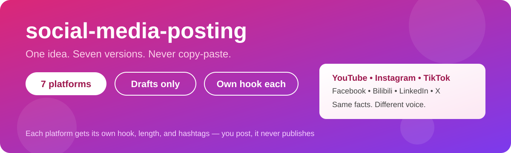
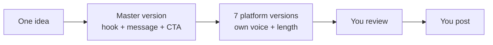

<p align="center">
  
</p>

<p align="center">
  <a href="https://github.com/smabdulmueid97/social-media-posting/blob/main/LICENSE"></a>
  <a href="https://github.com/smabdulmueid97/social-media-posting"></a>
  <a href="https://github.com/smabdulmueid97/social-media-posting"></a>
  <a href="https://github.com/smabdulmueid97/social-media-posting/stargazers"></a>
</p>

<h1 align="center">social-media-posting</h1>

<p align="center">
  A Claude Code skill that turns one idea, video, or announcement into platform-ready posts for <b>YouTube, Instagram, Facebook, TikTok, Bilibili, LinkedIn, and X</b>.<br />
  One source, seven versions — each with its own hook, length, and hashtags. <b>Never the same text pasted everywhere.</b>
</p>

<p align="center">
  <a href="#-install-30-seconds">Install</a> •
  <a href="#-use-it">Use it</a> •
  <a href="#-platform-specs">Specs</a> •
  <a href="#-rules">Rules</a> •
  <a href="#-layout">Layout</a>
</p>

---



## 🚀 Install (30 seconds)

```bash
git clone https://github.com/smabdulmueid97/social-media-posting.git
./install.sh
# copies this skill to ~/.claude/skills/social-media-posting/
```

Or manually: copy `SKILL.md` to `~/.claude/skills/social-media-posting/SKILL.md`.

## 💬 Use it

```
post this launch to YouTube, Instagram, TikTok, Bilibili, LinkedIn and X
```

Fill in `templates/post-brief.md` first if you want — what it is, audience, link, what they should do next, tone, and anything it must (or must not) say.

## 📏 Platform specs — checked Oct–Nov 2026, verify before posting

| Platform | Format | Best length | Caption / title limit |
|---|---|---|---|
| YouTube | Long-form 16:9, or Shorts 9:16 | Shorts: ≤3 min to count as a Short | Title ≤100 chars, description ≤5,000 |
| Instagram | Reels 9:16 1080×1920 | 30–90 s best; Reels up to 20 min, >3 min not recommended to new audiences | Caption ≤2,200 chars, up to 30 hashtags (use 5–10) |
| Facebook | Reels — since Sep 2025 all video posts as Reels | 30–90 s best | First 2 lines are the hook |
| TikTok | Vertical 9:16 1080×1920 | 30–90 s best; upload up to 60 min in app | Caption ≤2,200 chars, 3–5 hashtags |
| Bilibili (哔哩哔哩) | 16:9 1920×1080 or vertical 9:16 | 3–15 min sweet spot; up to 10 h | Title ≤80 chars, description ≤2,000 chars |
| LinkedIn | Native video, 4:5 (1080×1350) or 9:16 | 30–120 s best; max 15 min | Post text ≤3,000 chars |
| X | Video 16:9, 1:1, or 9:16 | 15–90 s best; free accounts max 2 min 20 s / 512 MB | Post ≤280 chars, 1–2 hashtags max |

Universal export: vertical 9:16, 1080×1920, H.264 MP4 + AAC, ≤3 min — valid as a Short, Reel, and TikTok.

## 🛑 Rules

- Drafts only — it never publishes anything itself. You post, or use the platform's scheduler.
- Facts stay identical everywhere: same link, same price, same date.
- No invented follower counts, views, or "best time to post" data.
- No watermarked reposts across platforms, and no machine-translated Chinese titles for Bilibili.

## 🗂️ Layout

```
SKILL.md                     # the skill
templates/post-brief.md      # input brief
install.sh                   # copies the skill to ~/.claude/skills/
```

## License

MIT
